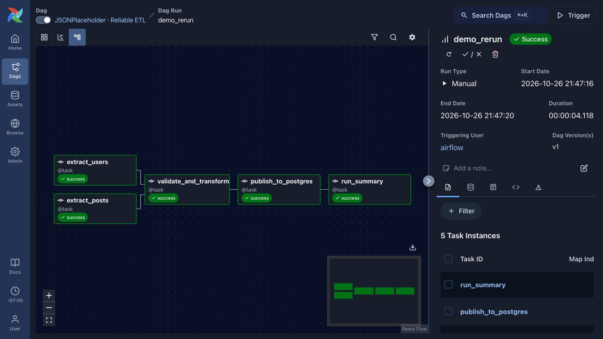
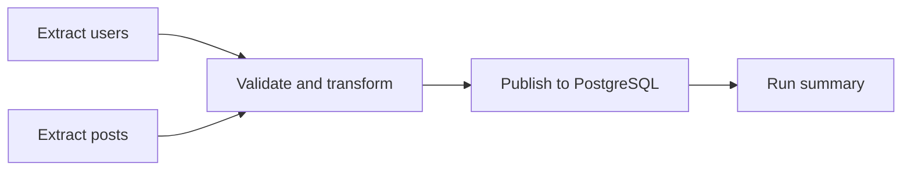

# JSONPlaceholder · Reliable ETL

An Airflow pipeline that downloads users and posts, validates their relationships, and loads PostgreSQL without duplicating records on reruns.

**Airflow 3.3.2 · PostgreSQL · Docker Compose**



## Run

```bash
docker compose up --build
```

Open [Airflow](http://localhost:8080) and sign in with `airflow` / `airflow`. The **JSONPlaceholder · Reliable ETL** DAG is enabled automatically and runs daily. Use **Trigger** to start another run.

This is a local demo using JSONPlaceholder's fictional data. Airflow's standalone mode keeps the setup small; the UI is bound to localhost.

## Pipeline



- Each run keeps its API responses under `data/`. Retries reuse the same snapshot, with file paths passed through XCom.
- Validation rejects empty responses, duplicate IDs, invalid coordinates, missing required fields, and posts without a matching source user.
- Users and posts load in one transaction. Primary keys prevent duplicates; a foreign key enforces the relationship.
- Content hashes distinguish inserted, updated, and unchanged records. Unchanged rows keep their original timestamps.
- A completed run is recorded in `api_json.pipeline_runs` in the same transaction. Repeating its run ID returns the committed result.
- Missing API records are not treated as deletions. New runs fetch current responses; this source does not provide historical snapshots.

## Inspect the results

Run summaries are available in the `run_summary` task logs and PostgreSQL:

```bash
docker compose exec postgres psql -U warehouse -d jsonplaceholder \
  -c 'SELECT * FROM api_json.pipeline_runs ORDER BY completed_at DESC;'
```

Explore the author summary:

```bash
docker compose exec postgres psql -U warehouse -d jsonplaceholder \
  -c 'SELECT * FROM api_json.author_summary ORDER BY post_count DESC, user_id;'
```

Trigger the DAG twice. With unchanged source data, the second run should report 10 unchanged users and 100 unchanged posts, and the table counts should remain 10 and 100.

## Storage and configuration

`data/` contains source and prepared JSON snapshots and is excluded from Git. PostgreSQL and Airflow logs use Docker volumes. Airflow metadata and ETL tables live in separate databases. Containers connect directly through the Compose network.

CI starts the Docker stack and checks DAG imports on pushes to `main` that change the Dockerfile or Compose configuration.

The Dockerfile pins the official Airflow image and its bundled Python dependencies. `AIRFLOW_PORT` can change the host UI port, for example `AIRFLOW_PORT=8081 docker compose up --build`.

```bash
docker compose down
```

Stopping the stack keeps the data volumes. Existing deployments from the original repository need a separate schema migration; the initialization SQL applies to a new database volume.

Source: [JSONPlaceholder](https://jsonplaceholder.typicode.com/) · Orchestration: [Apache Airflow](https://airflow.apache.org/)
